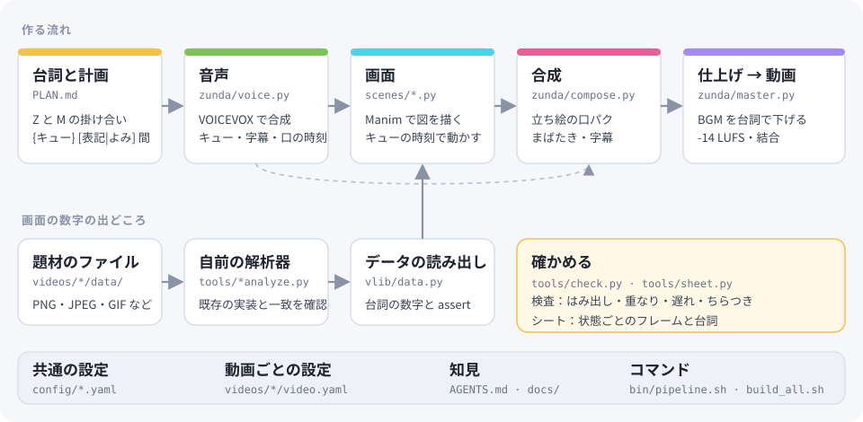

# ずんだもん解説動画編集ハーネス

ずんだもんと四国めたんの掛け合いで、ファイル形式などの仕組みを「高校生にも分かるように」解説する動画を作るための道具と知見。
[Manim](https://www.manim.community/) で画面を描き、[VOICEVOX](https://voicevox.hiroshiba.jp/) で声を作り、
立ち絵の口パク・字幕・BGM を重ねて 1080p の動画にする。画面に出す数字は、題材のファイルを自前で読み解いて計算する。

エージェント (Claude Code など) が読んで動画を作れるように、知見を [docs/](docs/) に、入口を [AGENTS.md](AGENTS.md) にまとめている。

## 作った動画

| 動画 | YouTube | 動画ファイル |
|---|---|---|
| PNG 編：6.9MBの画像が333KBに！？1バイトも消えないPNG圧縮の仕組み | https://youtu.be/BhYgIYsvkBo | [Release png-v1](../../releases/tag/png-v1) |
| JPEG 編：写真は「波」でできている！？JPEG圧縮の仕組みをやさしく解説 | https://youtu.be/dZP4YsrL6nw | [Release jpeg-v1](../../releases/tag/jpeg-v1) |
| GIF 編：GIFは「辞書」で縮む！？動く画像の中身を1バイトずつのぞいてみた | https://youtu.be/1bv3UpIbnM4 | [Release gif-v1](../../releases/tag/gif-v1) |
| WebP 編：同じ写真が3割小さい！？WebPがJPEGに勝てる理由を1バイトずつ読んでみた | https://youtu.be/pWV0v-tolTU | [Release webp-v1](../../releases/tag/webp-v1) |
| HEIC 編：謎の拡張子HEIC、実はWebPより2割小さかった | https://youtu.be/-Aqzhf8QRy0 | [Release heic-v1](../../releases/tag/heic-v1) |

それぞれの台詞・シーン・解析器は [videos/](videos/) にある。

## しくみ



## 使い方

```bash
uv sync
uv run python tools/fetch_assets.py   # BGM・効果音・フォント。立ち絵は docs/setup.md
bin/voice.sh gif                      # 台詞の音声 (VOICEVOX を 127.0.0.1:50021 に立てておく)
bin/pipeline.sh gif S05               # 1 シーンの試し (540p) → videos/gif/build/out/S05.mp4
bin/build_all.sh gif                  # 通し (1080p) → videos/gif/build/out/gif_video.mp4
```

新しい動画は [docs/workflow.md](docs/workflow.md) の流れで、[docs/templates/](docs/templates/) から作る。

## 構成

| 場所 | 中身 |
|---|---|
| [AGENTS.md](AGENTS.md) | エージェント向けの入口 |
| [docs/](docs/) | 知見 (流れ、台詞、画面、音と字幕、検査、エージェントへの頼み方、公開、環境) |
| [zunda/](zunda/) | 共通の Python パッケージ |
| [config/](config/) | 共通の設定 (立ち絵と表情、声、読み、音、素材とクレジット) |
| [tools/](tools/)・[bin/](bin/) | 共通の道具とコマンド |
| [videos/](videos/) | 動画ごとの台詞・シーン・解析器・データ |

## ライセンス

コード・文書・設定・自作のデータは [MIT](LICENSE)。第三者の素材は [THIRD_PARTY.md](THIRD_PARTY.md)。

クレジット：音声 VOICEVOX:ずんだもん、VOICEVOX:四国めたん / 立ち絵 坂本アヒル 様 / 音楽 甘茶の音楽工房 / 効果音 効果音ラボ /
フォント Zen Maru Gothic、M PLUS Rounded 1c、JetBrains Mono / 映像 Manim Community / 写真 Chelsea the cat (Stefan van der Walt, CC0)
